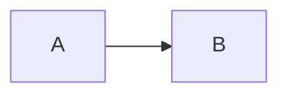

# render

Render Mermaid source to an SVG document in Node.

`render` from `ondine/compiler` compiles with the speed-optimized module for every diagram type. The module loads on the first call, and later calls use the same instance. The [Node Compiler](/docs/guides/node) guide shows common tasks.

```ts title="build.ts"
import { render } from 'ondine/compiler'

// Compiles synchronously and returns the SVG with its metadata
const { svg } = render('flowchart LR\n  A --> B')
```



## Signature

```ts
// Throws RenderError if the source cannot be rendered
render(source, options?)
```

## Parameters

### source

- **Type:** `string{:ts}`

The Mermaid source, with optional front matter and `%%{init}%%` directives. The compiler detects the diagram type from the first keyword.

```ts
import { render } from 'ondine/compiler'

// Detects a sequence diagram
render('sequenceDiagram\n  Alice->>Bob: Hi')
```

### options.autoDirection

- **Type:** `boolean{:ts}`
- **Default:** `true{:ts}`

If this option is `true` and a diagram that runs across does not fit `maxWidth`, the layout turns the diagram to run down.

```ts
import { render } from 'ondine/compiler'

// Keeps left-to-right even when the chain is wider than 400 pixels
render('flowchart LR\n  A --> B --> C --> D --> E', { autoDirection: false, maxWidth: 400 })
```

### options.directionBreakpoint

- **Type:** `number{:ts}`
- **Default:** `640{:ts}`

The width in pixels below which `autoDirection` turns a diagram.

```ts
import { render } from 'ondine/compiler'

// Turns diagrams only in columns narrower than 480 pixels
render('flowchart LR\n  A --> B', { directionBreakpoint: 480, maxWidth: 400 })
```

### options.fontSize

- **Type:** `number{:ts}`
- **Default:** `16{:ts}`

The font size, in pixels. The compiler measures each label character at 0.6 of this size, so shapes grow with the font size.

```ts
import { render } from 'ondine/compiler'

// Draws labels at 20 pixels
render('flowchart LR\n  A --> B', { fontSize: 20 })
```

### options.idPrefix

- **Type:** `string{:ts}`
- **Default:** `'ondine'{:ts}`

The prefix for the IDs of the accessible title and description that `accTitle` and `accDescr` produce. Give each diagram on a page a different prefix.

```ts
import { render } from 'ondine/compiler'

// Emits <title id="intro-title">
render('flowchart LR\n  accTitle: Request flow\n  A --> B', { idPrefix: 'intro' })
```

### options.limit

- **Type:** `number{:ts}`
- **Default:** `50000{:ts}`

The maximum number of source characters. If the source is longer, `render` throws a `RenderError` with code `limit`.

```ts
import { render } from 'ondine/compiler'

// Rejects source over 10,000 characters
render('flowchart LR\n  A --> B', { limit: 10_000 })
```

### options.maxEdges

- **Type:** `number{:ts}`
- **Default:** `5000{:ts}`

The maximum number of edges in a flowchart. If a flowchart has more edges, `render` throws a `RenderError` with code `limit`.

```ts
import { render } from 'ondine/compiler'

// Rejects flowcharts with more than 500 edges
render('flowchart LR\n  A --> B', { maxEdges: 500 })
```

### options.maxWidth

- **Type:** `number{:ts}`

The width available to the diagram, in pixels. If this option is not set, the diagram uses the width that its layout needs.

```ts
import { render } from 'ondine/compiler'

// Lays out for a 640-pixel column
render('flowchart LR\n  A --> B', { maxWidth: 640 })
```

### options.now

- **Type:** `number{:ts}`
- **Default:** `Date.now(){:ts}`

The time that gantt charts schedule against, in milliseconds since the epoch. The compiler reads no clock, so a fixed value makes the output reproducible.

```ts
import { render } from 'ondine/compiler'

// Schedules against January 15, 2024
render('gantt\n  section A\n  Task :3d', { now: Date.UTC(2024, 0, 15) })
```

### options.outputLimit

- **Type:** `number{:ts}`
- **Default:** `4000000{:ts}`

The maximum number of SVG characters. If the output is longer, `render` throws a `RenderError` with code `limit`.

```ts
import { render } from 'ondine/compiler'

// Rejects SVG over 1,000,000 characters
render('flowchart LR\n  A --> B', { outputLimit: 1_000_000 })
```

### options.padding

- **Type:** `number{:ts}`
- **Default:** `8{:ts}`

The padding around the diagram, in pixels.

```ts
import { render } from 'ondine/compiler'

// Draws the diagram flush with its edges
render('flowchart LR\n  A --> B', { padding: 0 })
```

### options.responsive

- **Type:** `boolean{:ts}`
- **Default:** `true{:ts}`

Whether the SVG scales to its container. Responsive output sets `max-width: 100%` and `height: auto` on the root element.

```ts
import { render } from 'ondine/compiler'

// Keeps the SVG at its intrinsic width and height
render('flowchart LR\n  A --> B', { responsive: false })
```

### options.theme

- **Type:** `render.Theme{:ts}`

Writes the theme into the SVG as literal values. The output has no `var()` or `color-mix()`, so renderers without CSS custom properties can draw it, such as resvg, librsvg, and native SVG parsers.

Each key is an `--ondine-*` property name without its prefix, in camel case: `accent`, `bg`, `boldWeight`, `border`, `critical`, `fg`, `font`, `headingWeight`, `line`, `muted`, `radius`, `series1` to `series8`, `stroke`, `surface`, `surfaceAlt`, and `titleWeight`. A property without a key keeps its [default](/docs/guides/theming). An empty object writes the default theme.

Default shades mix `fg` into `bg`. Give these two as hex or `transparent` colors, and the compiler writes each shade as a hex color. The SVG then ignores `--ondine-*` properties on the page, so a new theme needs a new render.

```ts
import { render } from 'ondine/compiler'

// Writes the dark scheme with rounded corners as fixed values
render('flowchart LR\n  A --> B', { theme: { bg: '#000', fg: '#fff', radius: '6px' } })
```

## Returns

### height

- **Type:** `number{:ts}`

The height in pixels. This value is equal to the `height` attribute of the root `<svg>`.

```ts
import { render } from 'ondine/compiler'

// Reserves space before the diagram loads
const { height, width } = render('flowchart LR\n  A --> B')
```

### links

- **Type:** `readonly { href: string; id: string; internal: boolean }[]{:ts}`

The links from `click` directives, in drawing order. `id` names the element, and `internal` marks a link to a location in the same page.

```ts
import { render } from 'ondine/compiler'

// [{ href: 'https://example.com/', id: 'A', internal: false }]
const { links } = render('flowchart LR\n  A --> B\n  click A "https://example.com"')
```

### svg

- **Type:** `string{:ts}`

The SVG document. The root element has the classes `ondine` and `ondine-<type>`. Unless `theme` is set, the SVG reads its theme from `--ondine-*` custom properties.

```ts
import { render } from 'ondine/compiler'

// '<svg xmlns="http://www.w3.org/2000/svg" class="ondine ondine-flowchart" …'
const { svg } = render('flowchart LR\n  A --> B')
```

### type

- **Type:** `string{:ts}`

The detected diagram type, such as `flowchart`, `sequence`, or `gitGraph`.

```ts
import { render } from 'ondine/compiler'

// 'pie'
const { type } = render('pie\n  "A" : 1')
```

### width

- **Type:** `number{:ts}`

The width in pixels. This value is equal to the `width` attribute of the root `<svg>`.

```ts
import { render } from 'ondine/compiler'

// 160
const { width } = render('flowchart LR\n  A --> B')
```

## Errors

### RenderError

If `render` cannot render the source, it throws a `RenderError`. The error `code` is `limit`, `semantic`, `syntax`, or `unsupported-diagram`. See [`RenderError`](/docs/api/compiler/RenderError).

```ts
import { render, RenderError } from 'ondine/compiler'

try {
  render('not a diagram')
} catch (error) {
  // 'unsupported-diagram': No diagram type detected for the given text.
  if (error instanceof RenderError) console.log(error.code, error.message)
}
```
