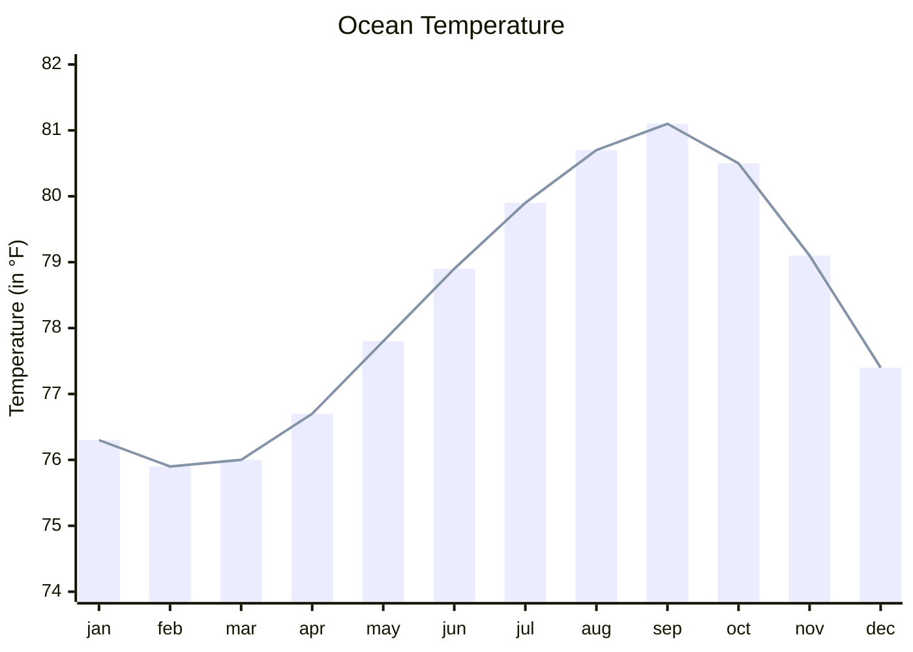
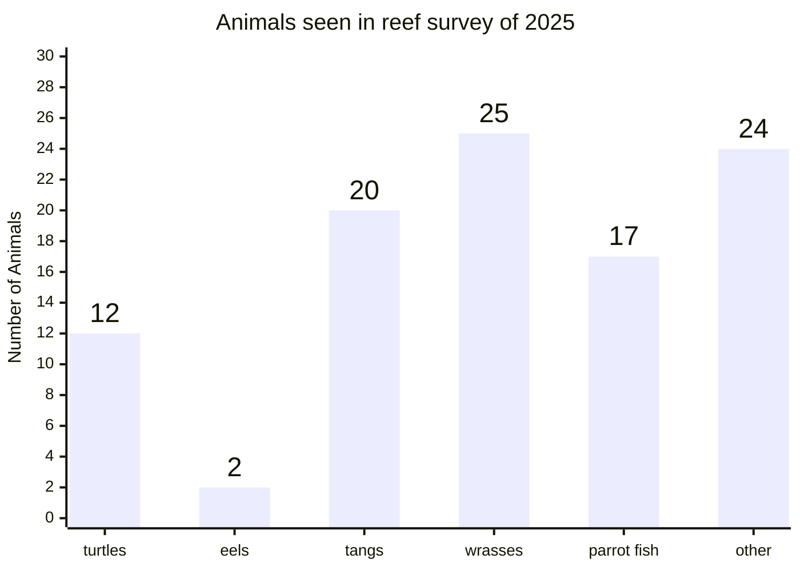
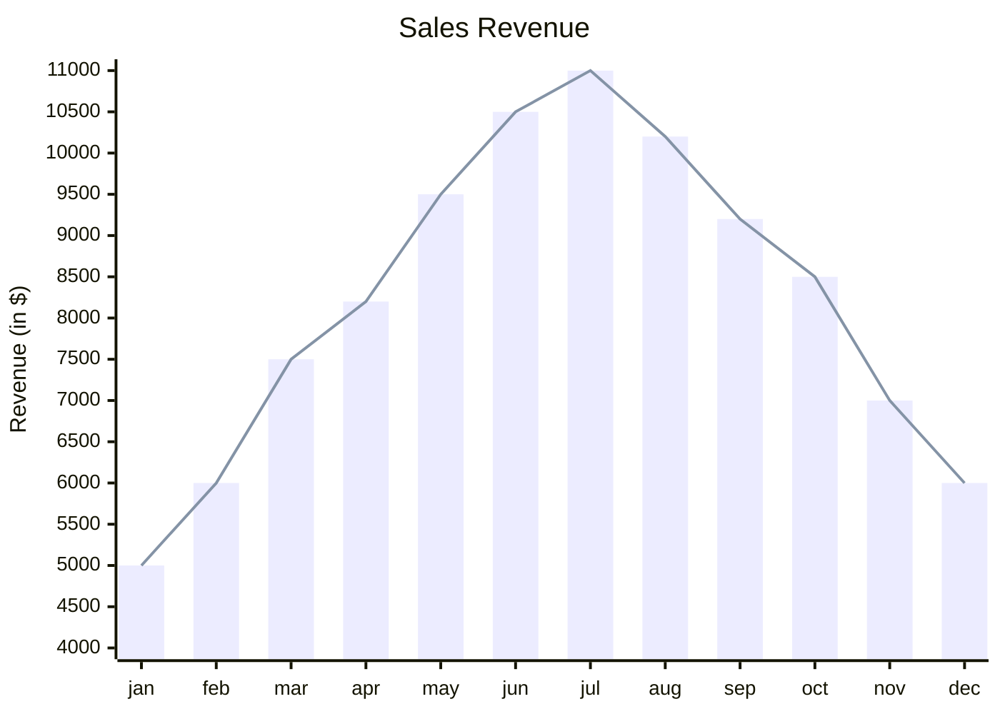
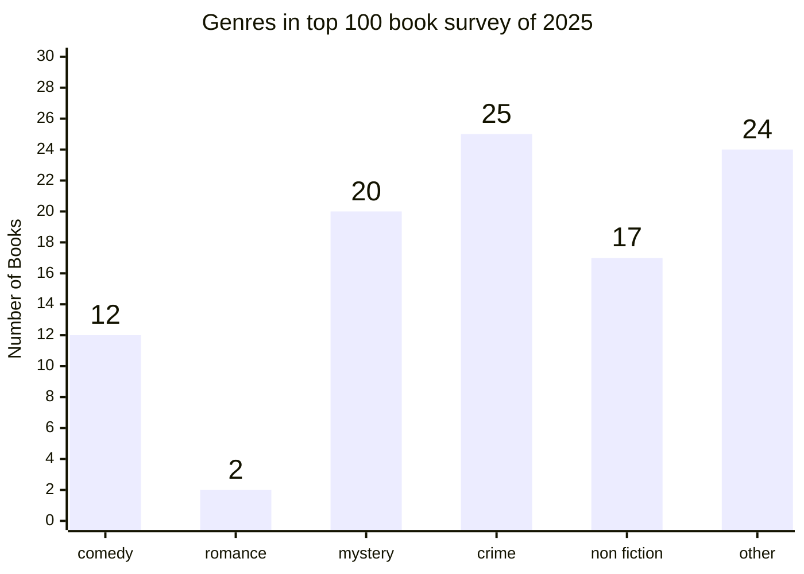
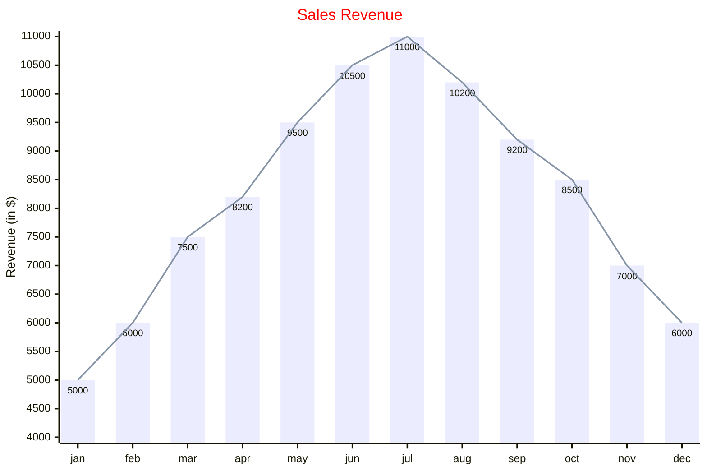

{/* Generated by scripts/generate.ts. Do not edit. */}

# XY Chart

Bar and line series on an x and y axis.

## Stacked Bars

The `stacked` option of `xyChart` draws all bar series as one bar per category. Positive values stack above the baseline, and negative values stack below it. Lines do not stack.

If no `y-axis` range is set, the value axis fits the stack totals. With `showDataLabel`, each stack shows its total.

```mermaid
---
config:
  xyChart:
    stacked: true
    showDataLabel: true
---
xychart
    title "Orders by channel"
    x-axis [Q1, Q2, Q3, Q4]
    %% Each bar series is one layer of the stack
    bar "Online" [12, 15, 18, 22]
    bar "Store" [8, 7, 9, 10]
    bar "Partner" [3, 4, 6, 7]
```

## Examples

The playground samples for this type, rendered by Ondine when the documentation builds.

### Example 1

### Example 2

### Example 3

### Example 4

```mermaid
---
config:
  themeVariables:
    xyChart:
      plotColorPalette: '#000000, #0000FF, #00FF00, #FF0000'
---
xychart
title "Different Colors in xyChart"
x-axis "categoriesX" ["Category 1", "Category 2", "Category 3", "Category 4"]
y-axis "valuesY" 0 --> 50
%% Black line
line [10,20,30,40]
%% Blue bar
bar [20,30,25,35]
%% Green bar
bar [15,25,20,30]
%% Red line
line [5,15,25,35]

```

### Example 5

### Example 6

