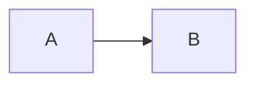

# Swift Package

Render Mermaid to SVG in native apps and Swift servers with the modules of `ondine/compiler/wasm`.

## Overview

The `Ondine` Swift package renders Mermaid source on macOS, iOS, and Linux. It runs a compiler module from the npm package in the WasmKit interpreter. iOS allows no JIT, so the package interprets the module instead of compiling it.

```swift title="Diagram.swift"
import Foundation
import Ondine

// Renders with the module for every diagram type
let compiler = try Ondine.Compiler(module: Data(contentsOf: url))
let rendered = try compiler.render("flowchart LR\n  A --> B")
```



The package needs Swift 6.3, and macOS 15 or iOS 18 on Apple platforms. For the same module and options, the SVG is the SVG that `ondine/compiler/wasm` returns.

## Walkthrough

The steps below render diagrams in an app target.

### Add the Package

The Swift package manifest is at the root of the repository. Add the repository URL to the dependencies of the package, and add the `Ondine` product to the target.

```swift title="Package.swift"
// Depends on the repository, which holds the Swift package manifest
dependencies: [
  .package(url: "https://github.com/wevm/ondine.git", branch: "main"),
],
```

### Bundle the Module

The package contains no WebAssembly. Copy `all.generated.wasm` from `node_modules/ondine/dist/internal/` into the target as a resource. `Ondine.Compiler` takes this one module, which holds every diagram type.

```swift title="Package.swift"
// Copies the module into the bundle of the target
.target(
  name: "App",
  dependencies: [.product(name: "Ondine", package: "ondine")],
  resources: [.copy("Resources/all.wasm")]
),
```

### Render Source

Create the compiler once and keep it. The compiler instantiates the module on the first render, and later renders use the same instance. Rendering is synchronous and CPU-bound, so render large diagrams off the main thread.

```swift title="Diagram.swift"
import Foundation
import Ondine

// Parses the module once for the life of the app
let url = Bundle.module.url(forResource: "all", withExtension: "wasm")!
let compiler = try Ondine.Compiler(module: Data(contentsOf: url))

// Renders off the main thread and fits the diagram to a 640-pixel column
let svg = try await Task.detached {
  try compiler.render(source, options: .init(maxWidth: 640)).svg
}.value
```

### Handle Errors

`render` throws `Ondine.RenderError`. The `diagnostic` case carries the code, the one-based line and column, the snippet, and the message of `RenderError` from `ondine/compiler/wasm`.

```swift title="Diagram.swift"
do {
  _ = try compiler.render("flowchart LR\n  A --> B --> ]")
} catch Ondine.RenderError.diagnostic(let diagnostic) {
  // Prints the position and the message, such as 2:15: Lexical error on line 2
  print("\(diagnostic.line):\(diagnostic.column): \(diagnostic.message)")
}
```

| Case            | Thrown When                                     |
| --------------- | ----------------------------------------------- |
| `diagnostic`    | The source cannot be rendered.                  |
| `fuelExhausted` | The render uses all of `Options.fuel`.          |
| `invalidModule` | The bytes are not an Ondine module.             |
| `trap`          | The module traps or returns a malformed result. |

After `fuelExhausted` or `trap`, the next render uses a fresh instance of the module.

### Set Options

`Ondine.Options` has the fields of `render.Options`. A `nil` field uses the default of the compiler. The package sends the fields as the same JSON that the TypeScript wrapper sends.

| Option                | Type      | Description                                                                                        |
| --------------------- | --------- | -------------------------------------------------------------------------------------------------- |
| `autoDirection`       | `Bool?`   | Draws a diagram that runs across running down when it does not fit `maxWidth`. Defaults to `true`. |
| `directionBreakpoint` | `Double?` | The width under which `autoDirection` turns a diagram. Defaults to `640`.                          |
| `fontSize`            | `Double?` | Font size in pixels. Defaults to `16`.                                                             |
| `fuel`                | `UInt64`  | The most WebAssembly fuel one render may use. Defaults to `Options.defaultFuel`, one billion.      |
| `idPrefix`            | `String?` | Prefix for element IDs, to keep several diagrams on one page apart.                                |
| `limit`               | `Int?`    | The most characters of source to accept. Defaults to `50000`.                                      |
| `maxEdges`            | `Int?`    | The most edges a flowchart may have. Defaults to `5000`.                                           |
| `maxWidth`            | `Double?` | The width available to the diagram, in pixels.                                                     |
| `now`                 | `Date?`   | The time a gantt chart schedules against. Defaults to the current time.                            |
| `outputLimit`         | `Int?`    | The most characters of SVG to produce. Defaults to `4000000`.                                      |
| `padding`             | `Double?` | Padding around the diagram, in pixels. Defaults to `8`.                                            |
| `responsive`          | `Bool?`   | Whether the SVG scales to its container. Defaults to `true`.                                       |

## Recipes

### Bound the Work

WasmKit counts fuel, about one unit for each executed instruction. A render that uses all of `fuel` stops with `fuelExhausted`, so a pathological source cannot hold a thread.

`Options.defaultFuel` is one billion units, about one second of interpretation in an optimized build. Every sample diagram in the documentation uses less than ten million units. Raise `fuel` to render larger diagrams.

```swift title="Diagram.swift"
// Allows about ten billion instructions for a very large diagram
let rendered = try compiler.render(source, options: .init(fuel: 10_000_000_000))
```

### Load One Type

If an app renders only one diagram type, bundle the module for that type, such as `flowchart.generated.wasm`. The compiler then renders only that type. For other types, it throws a diagnostic with the `unsupportedDiagram` code.

```swift title="Diagram.swift"
// Renders flowcharts, and throws a diagnostic for other types
let compiler = try Ondine.Compiler(module: Data(contentsOf: flowchart))
```

### Render in Parallel

`Ondine.Compiler` is `Sendable`. A lock runs the renders of one compiler one at a time. To render on several threads at once, create one compiler for each thread.

```swift title="Diagram.swift"
// Renders each source on its own compiler
let svgs = try await withThrowingTaskGroup(of: String.self) { group in
  for source in sources {
    group.addTask { try Ondine.Compiler(module: module).render(source).svg }
  }
  return try await group.reduce(into: []) { $0.append($1) }
}
```

## More

<Cards>
  <Card
    title="In-Browser Compilation"
    icon="cpu"
    to="/docs/guides/browser"
    description="Render with the same modules in browsers."
  />
  <Card
    title="create"
    icon="code"
    to="/docs/api/compiler/create"
    description="Make a renderer from specific modules."
  />
  <Card
    title="Benchmarks"
    icon="gauge"
    to="/docs/introduction/benchmarks"
    description="Module sizes for each diagram type."
  />
</Cards>
