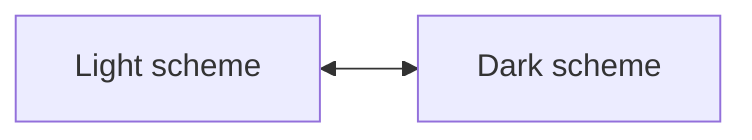
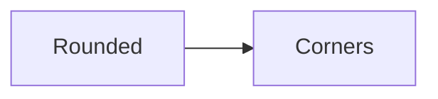
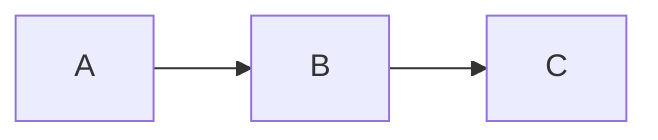
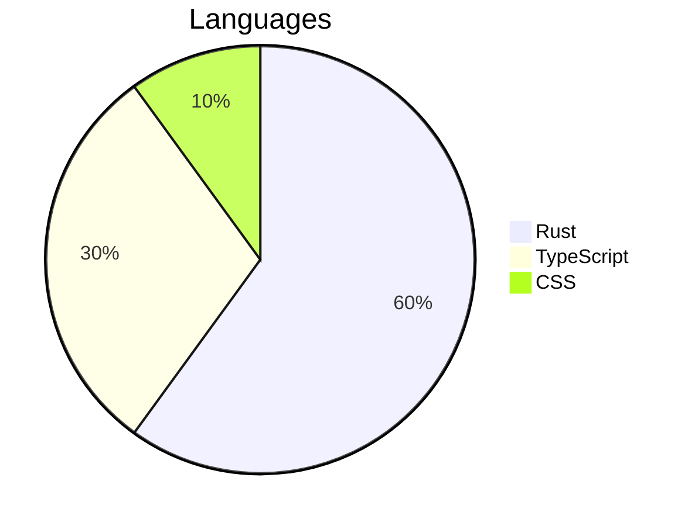
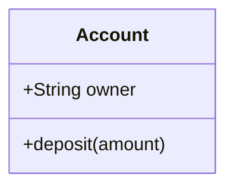

# Theming

Set a diagram's colors, font, corners, and strokes with CSS custom properties, without compiling again.

## Overview

Each compiled diagram reads its appearance from `--ondine-*` custom properties on the root `<svg>` or on an ancestor. If a property is not set, the diagram uses the default: a white background, a black foreground, square corners, and a monospace font.

Two properties set the theme of a full diagram. Node fills use `--ondine-bg`. Lines, borders, and text use `--ondine-fg`.

```css title="styles.css"
/* Draws each diagram on the page in white text on a black background */
.ondine {
  --ondine-bg: #000;
  --ondine-fg: #fff;
}
```

Each SVG has the classes `ondine` and `ondine-<type>`, such as `ondine-flowchart`. A rule can use the second class to select one diagram type.

### Properties

| Property                                   | Default                                                                                           | Applies to                                  |
| ------------------------------------------ | ------------------------------------------------------------------------------------------------- | ------------------------------------------- |
| `--ondine-bg`                              | `#fff`                                                                                            | Background, and the default for fills       |
| `--ondine-fg`                              | `#000`                                                                                            | Text, and the default for lines and borders |
| `--ondine-line`                            | `--ondine-fg`                                                                                     | Edges and connectors                        |
| `--ondine-border`                          | `--ondine-fg`                                                                                     | Shape outlines                              |
| `--ondine-muted`                           | `--ondine-fg`                                                                                     | Secondary text                              |
| `--ondine-surface`                         | `--ondine-bg`                                                                                     | Node fills                                  |
| `--ondine-surface-alt`                     | 20% `--ondine-fg`                                                                                 | Cluster fills, grids, and finished work     |
| `--ondine-accent`                          | `--ondine-fg`                                                                                     | Highlighted elements                        |
| `--ondine-critical`                        | `--ondine-fg`                                                                                     | Elements a diagram marks as critical        |
| `--ondine-series-1` to `--ondine-series-8` | Foreground shades                                                                                 | Chart series                                |
| `--ondine-font`                            | `ui-monospace, SFMono-Regular, Menlo, Consolas, 'Liberation Mono', 'DejaVu Sans Mono', monospace` | Label font stack                            |
| `--ondine-stroke`                          | `2px`                                                                                             | Outline and edge width                      |
| `--ondine-radius`                          | `0`                                                                                               | Rectangle corner radius                     |
| `--ondine-title-weight`                    | `bold`                                                                                            | Diagram titles                              |
| `--ondine-heading-weight`                  | `bold`                                                                                            | Section and group headings                  |
| `--ondine-bold-weight`                     | `bold`                                                                                            | Bold labels                                 |

## Walkthrough

The steps below make the diagrams on a page follow the color scheme and use the font of the page.

### Follow the Scheme

`light-dark()` selects a value from the `color-scheme` of the element. Thus one declaration sets the colors for the two schemes.

```css title="styles.css"
/* Swaps the background and foreground colors when the color scheme changes */
:root {
  color-scheme: light dark;
}

.ondine {
  --ondine-bg: light-dark(#fff, #000);
  --ondine-fg: light-dark(#000, #fff);
}
```

This site sets the same two properties. Thus each diagram on this site follows the theme switch.



### Match the Page

Set `--ondine-bg` to the color of the surface below the diagram. The node fills then match the page.

```css title="styles.css"
/* Uses the surface color of the page for node fills */
.ondine {
  --ondine-bg: var(--surface);
}
```

### Set the Font

`--ondine-font` replaces the font stack. Ondine measures each character at 0.6 em. Thus a monospace font keeps labels inside their shapes.

```css title="styles.css"
/* Draws labels in the monospace font of the page */
.ondine {
  --ondine-font: 'Geist Mono', ui-monospace, monospace;
}
```

## Recipes

### Round Corners

Rectangles have square corners by default. `--ondine-radius` sets the corner radius.

```css title="styles.css"
/* Rounds the corners of nodes */
.ondine {
  --ondine-radius: 6px;
}
```

<Themed theme="rounded">



</Themed>

### Change Stroke Width

`--ondine-stroke` sets the width of shape outlines and edges. The default is `2px`.

```css title="styles.css"
/* Draws thicker outlines and edges */
.ondine {
  --ondine-stroke: 3px;
}
```

<Themed theme="stroke">



</Themed>

### Color Chart Series

Charts color each series with `--ondine-series-1` through `--ondine-series-8`. Each default is a shade that contains between half and all of the foreground color. Thus each series stays visible on the background.

```css title="styles.css"
/* Colors the first three series */
.ondine {
  --ondine-series-1: #2563eb;
  --ondine-series-2: #16a34a;
  --ondine-series-3: #d97706;
}
```

<Themed theme="series">



</Themed>

### Lighten Bold Text

Titles, headings, and bold labels read their font weights from `--ondine-title-weight`, `--ondine-heading-weight`, and `--ondine-bold-weight`.

```css title="styles.css"
/* Draws titles and bold labels at normal weight */
.ondine {
  --ondine-bold-weight: normal;
  --ondine-title-weight: normal;
}
```

<Themed theme="weights">



</Themed>

### Pin a Scheme

A diagram in an image cannot read the styles of the page. Thus the [image Worker](/docs/guides/github) puts the properties in the SVG. It draws the light scheme, or the dark scheme with `?scheme=dark`. The `?scheme=auto` value follows `prefers-color-scheme`.

```md title="README.md"
<!-- Shows the dark scheme for every reader -->


```

### Inline the Theme

Some SVG renderers have no CSS custom properties or `color-mix()`. Examples are resvg, librsvg, and the SVG parsers of native apps. The `theme` option of [`render`](/docs/api/compiler/render) writes each property value into the SVG instead.

```ts title="png.ts"
import { render } from 'ondine/compiler'

// Writes the dark scheme into the SVG as hex colors
const { svg } = render('flowchart LR\n  A --> B', {
  theme: { bg: '#000', fg: '#fff' },
})
```

Keys are the property names without the `--ondine-` prefix, in camel case, such as `surfaceAlt` and `series1`. The SVG then ignores `--ondine-*` properties on the page. Thus a new scheme needs a new render.

## More

<Cards>
  <Card
    title="Mounting"
    icon="layout"
    to="/docs/guides/mounting"
    description="Insert compiled diagrams into the page."
  />
  <Card
    title="GitHub Images"
    icon="image"
    to="/docs/guides/github"
    description="Embed diagrams in READMEs with light and dark variants."
  />
</Cards>
